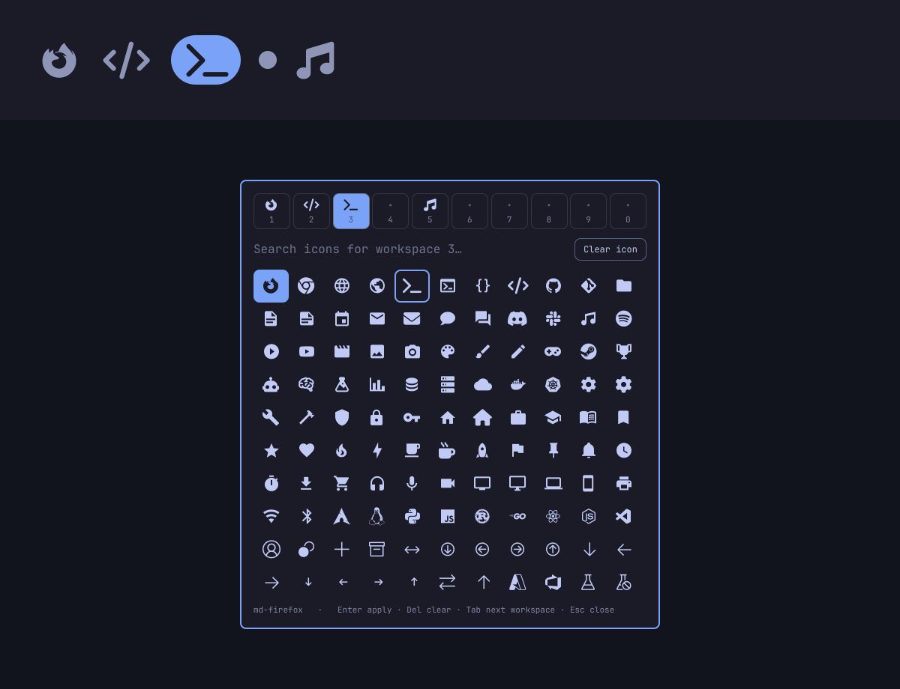

# Omarchy Workspace Icons

Animated workspace dots for the Omarchy bar, where every workspace can show an icon font glyph you choose. The focused workspace grows into a pill; a workspace with an icon shows it in place of its dot, and inside the pill when focused. Workspaces without an icon keep a plain dot.



## Compatibility

Works on Omarchy 4.0.6 (stable) and later, including the Quattro development channel. It only uses the parts of the Omarchy shell present since 4.0.6.

## Install

```bash
omarchy plugin add https://github.com/LucentDread/omarchy-workspace-icons.git --enable
```

Then turn off the stock numbers so the widget takes their place:

```bash
omarchy plugin disable omarchy.workspaces
```

To place it precisely: `omarchy bar move lucentdread.workspace-icons --section left --index 1`.

## Choosing icons

Right click any workspace in the bar to open the icon editor on it.

- The row at the top shows workspaces 1 to 10 (0 is workspace 10) with their current icon. Click one, or press **Tab** / **Shift+Tab**, to switch.
- Type to search about 10,000 Nerd Font glyphs by name: `firefox`, `terminal`, `music`, `steam`… With an empty search, a selection of common workspace icons comes first.
- Click a glyph or press **Enter** to apply it. Arrow keys move the selection.
- **Clear icon** or **Del** removes the icon and brings the dot back.
- **Esc** clears the search, then closes the editor.

Changes show in the bar right away.

The editor can also be opened from a terminal or a keybinding:

```bash
omarchy-shell shell toggle lucentdread.workspace-icons '{"workspace":3}'
```

## Where the icons are stored

Only in the plugin's own file, `~/.config/omarchy/workspace-icons.json`:

```json
{
  "version": 1,
  "icons": {
    "1": "󰈹",
    "2": "",
    "3": ""
  }
}
```

The plugin never writes to your Hyprland configuration or to `shell.json`. The file survives plugin updates, disabling and removal; delete it to forget your icons. You can edit it by hand: any glyph, emoji or short text (up to 8 characters) works, and the bar picks up changes as soon as the file is saved.

## Behaviour

- Shows workspaces 1 through the highest occupied or focused one, up to 10, like Workspace Dots.
- Left click focuses a workspace, right click opens the editor.
- Colors follow the active Omarchy theme. Horizontal and vertical bars are supported.
- The glyph list (`glyphs.tsv`) holds the Nerd Fonts glyphs present in JetBrainsMono Nerd Font 3.4.0, Omarchy's bar font, so every icon offered renders.

## Update

```bash
omarchy plugin update lucentdread.workspace-icons
```

Then restart the shell so the new version takes over: `omarchy-restart-shell`.

## Remove

```bash
omarchy plugin remove lucentdread.workspace-icons
```

```bash
omarchy plugin enable omarchy.workspaces --section left --index 0
```

## Development

```bash
node tests/icon-store-test.js
```

## Credits

Based on [Workspace Dots](https://github.com/voyagen/oma-dots) by Voyagen (MIT). Glyph names from [Nerd Fonts](https://github.com/ryanoasis/nerd-fonts) (MIT).

## License

MIT. See [LICENSE](LICENSE).
